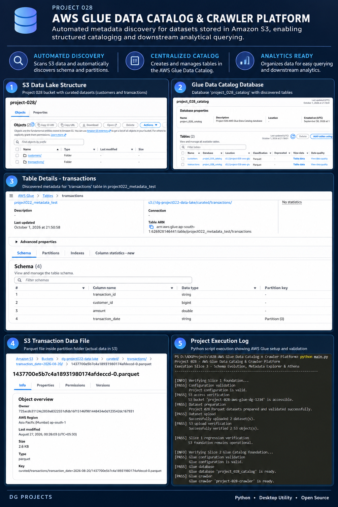
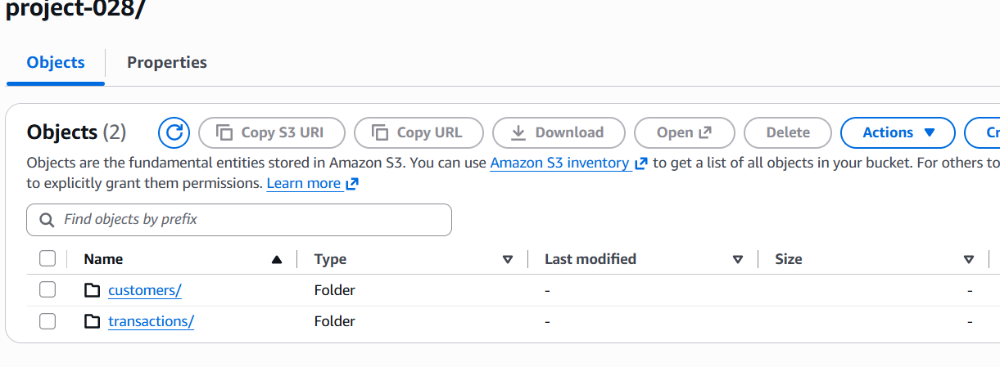
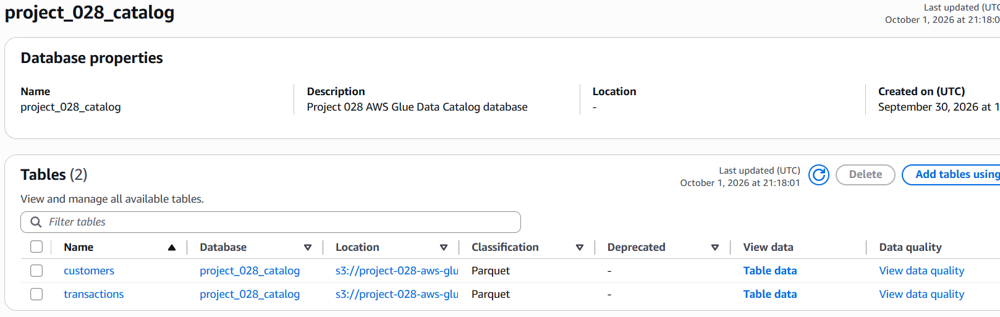
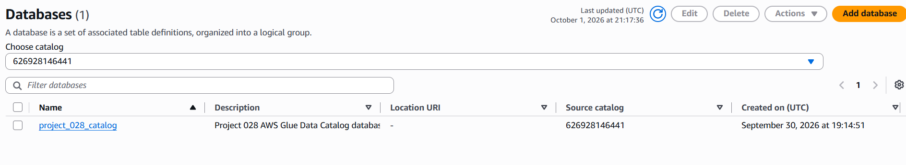

# 2. Project Badges

   
 


# 3. Screenshots

  -------------------------------------------------------------------------------------------------
  **Screenshot**                                                **Description**
  ------------------------------------------------------------- -----------------------------------
      Project 028 S3 prefix structure
                                                                containing `customers/` and
                                                                `transactions/`.

    `project_028_catalog` with the
                                                                discovered `customers` and
                                                                `transactions` tables.

                 AWS Glue database registration for
                                                                Project 028.

     showing table schema and partition
                                                                metadata.

             Project 028 S3 and Glue foundation
                                                                validation.
  -------------------------------------------------------------------------------------------------

# 4. Project Title

# Project 028 --- AWS Glue Data Catalog & Crawler Platform

# 5. Project Overview

Project 028 implements an automated metadata-discovery layer for
datasets stored in Amazon S3. It prepares Parquet datasets, uploads them
to S3, uses an AWS Glue crawler to discover their structure, and
registers the discovered metadata in the AWS Glue Data Catalog.

The project addresses the problem of maintaining searchable metadata for
S3-based data without requiring every dataset to be manually registered.

Typical use cases include:

-   Discovering schemas from Parquet datasets stored in Amazon S3.
-   Registering S3 datasets as AWS Glue Data Catalog tables.
-   Capturing columns, data types, table locations, and partition
    metadata.
-   Validating Glue database and crawler configuration programmatically.
-   Providing reusable metadata services for downstream data-engineering
    workflows.
-   Supporting controlled schema-comparison workflows for future schema
    changes.
-   Preparing catalog metadata for SQL-based downstream analytics
    through Athena.

# 6. Features

-   Project configuration and AWS environment validation.
-   Local customer and transaction Parquet dataset preparation.
-   Amazon S3 bucket access, upload, and object verification.
-   AWS Glue database creation and validation.
-   AWS Glue crawler creation, configuration, and execution.
-   Glue crawler status polling and completion handling.
-   Automatic discovery of S3 dataset tables in the Glue Data Catalog.
-   Catalog table, column, data-type, location, and partition metadata
    extraction.
-   Required-column and S3-location validation.
-   Schema comparison support for added, removed, and type-changed
    columns.
-   Metadata explorer workflow for catalog inspection.
-   Athena query workflow and result normalization support.
-   Structured execution reporting with checkpoints, errors, duration,
    and final status.
-   Slice-level regression verification between the S3 foundation and
    Glue Catalog layers.

# 7. Technology Stack

  -----------------------------------------------------------------------
  **Technology**                      **Purpose**
  ----------------------------------- -----------------------------------
  Python 3.14                         Application implementation and
                                      workflow orchestration

  AWS Glue Data Catalog               Central metadata repository for
                                      discovered S3 datasets

  AWS Glue Crawlers                   Automated schema and partition
                                      discovery

  Amazon S3                           Dataset storage and cloud data-lake
                                      foundation

  Amazon Athena                       SQL query workflow over cataloged
                                      S3 data

  boto3                               Python integration with AWS S3,
                                      Glue, and Athena APIs

  Apache Parquet                      Columnar dataset format used by the
                                      project

  PyArrow                             Local Parquet dataset preparation
                                      and schema handling

  Git                                 Source control

  GitHub                              Repository and release management
  -----------------------------------------------------------------------

# 8. Project Structure

``` text
028-AWS Glue Data Catalog n Crawler Platform/
│
├── .github/
├── .gitignore
├── .vscode/
├── check_glue_customers.py
├── LICENSE
├── main.py
├── pyproject.toml
├── README.md
├── requirements.txt
│
├── assets/
│   ├── fonts/
│   ├── icons/
│   ├── images/
│   └── templates/
│
├── data/
│   ├── input/
│   ├── output/
│   ├── samples/
│   │   ├── customers.parquet
│   │   └── transactions.parquet
│   │
│   └── schema_evolution/
│       ├── existing_customers.parquet
│       ├── transactions/
│       │   ├── transactions.csv
│       │   ├── transactions.parquet
│       │   └── transactions_preview.csv
│       ├── v1/
│       │   ├── customers.csv
│       │   ├── customers.parquet
│       │   └── customers_preview.csv
│       └── v2/
│           ├── customers.csv
│           ├── customers.parquet
│           └── customers_preview.csv
│
├── docs/
│   └── UserGuide.md
│
├── logs/
│   └── execution_report.txt
│
├── releases/
│   ├── latest/
│   ├── v1.0/
│   └── v1.1/
│
├── screenshots/
│   ├── another-s3-table-glue-data-catalog.PNG
│   ├── glue-crawler-screenshot.PNG
│   ├── glue-database.PNG
│   ├── poster.png
│   ├── S3-parquet--table-glue.PNG
│   └── S3-parquet-tables.PNG
│
├── src/
│   ├── config.py
│   │
│   ├── core/
│   │   ├── athena/
│   │   │   └── athena_workflow.py
│   │   ├── cloud_foundation/
│   │   │   └── foundation_workflow.py
│   │   ├── glue_catalog/
│   │   │   └── glue_catalog_workflow.py
│   │   ├── metadata_explorer/
│   │   │   └── metadata_explorer_workflow.py
│   │   └── schema_evolution/
│   │       └── schema_evolution_workflow.py
│   │
│   ├── models/
│   │
│   ├── services/
│   │   ├── athena_service.py
│   │   ├── catalog_service.py
│   │   ├── dataset_service.py
│   │   ├── execution_report_service.py
│   │   ├── glue_service.py
│   │   ├── s3_service.py
│   │   └── schema_evolution_service.py
│   │
│   ├── ui/
│   └── utils/
│
└── tests/
```

> Python `__pycache__` directories shown in the local tree are generated
> runtime artifacts and are intentionally omitted from the repository
> architecture above.

# 9. Module Overview

  -----------------------------------------------------------------------
  **Module**                          **Responsibility**
  ----------------------------------- -----------------------------------
  `main.py`                           Application entry point and
                                      end-to-end workflow orchestration.

  `src/config.py`                     Central project, AWS, dataset,
                                      path, and runtime configuration.

  `src/core/cloud_foundation/`        Builds and verifies the S3 data
                                      foundation and local dataset
                                      preparation workflow.

  `src/core/glue_catalog/`            Coordinates Glue database, crawler,
                                      catalog discovery, schema
                                      validation, and S3-location
                                      validation.

  `src/core/metadata_explorer/`       Retrieves and presents Glue Catalog
                                      metadata in a structured form.

  `src/core/schema_evolution/`        Coordinates baseline/current schema
                                      capture and controlled schema
                                      comparison.

  `src/core/athena/`                  Coordinates Athena query execution
                                      and normalized query-result
                                      processing.

  `src/services/`                     Provides reusable integrations and
                                      domain services for S3, Glue,
                                      Athena, datasets, catalog metadata,
                                      schema comparison, and execution
                                      reporting.

  `src/models/`                       Reserved location for project data
                                      models; no project-specific model
                                      files are currently present.

  `src/ui/`                           Reserved UI layer; this project is
                                      CLI/workflow based and currently
                                      has no UI modules.

  `src/utils/`                        Reserved shared utility layer; no
                                      project-specific utility files are
                                      currently present.

  `tests/`                            Reserved location for automated
                                      tests; no test source files are
                                      currently present in the supplied
                                      repository tree.
  -----------------------------------------------------------------------

# 10. Source Code Overview

  -----------------------------------------------------------------------------------------------------------------------
  **Source File**                                              **Purpose**                    **Dependencies**
  ------------------------------------------------------------ ------------------------------ ---------------------------
  `check_glue_customers.py`                                    Diagnostic utility used to     `boto3`, project
                                                               inspect the Project 028        configuration
                                                               customers table and verify     
                                                               Glue-discovered metadata       
                                                               against the AWS dataset.       

  `main.py`                                                    Application entry point.       Project workflows,
                                                               Coordinates foundation         `src.config`,
                                                               regression, Glue Catalog       `ExecutionReportService`
                                                               execution, metadata            
                                                               exploration, schema-evolution  
                                                               workflow, Athena workflow, and 
                                                               execution reporting.           

  `src/config.py`                                              Defines project identity, AWS  Python standard library
                                                               region, S3 and Glue            
                                                               configuration, dataset paths,  
                                                               S3 object keys, and            
                                                               configuration validation       
                                                               functions.                     

  `src/core/athena/athena_workflow.py`                         Coordinates the Athena layer   `AthenaService`, project
                                                               by validating configuration,   configuration
                                                               executing the configured SQL   
                                                               workload, and collecting       
                                                               normalized query results.      

  `src/core/cloud_foundation/foundation_workflow.py`           Executes the S3 foundation     `DatasetService`,
                                                               workflow: configuration        `S3Service`, project
                                                               validation, S3 access          configuration
                                                               verification, Parquet dataset  
                                                               preparation, upload, and       
                                                               upload verification.           

  `src/core/glue_catalog/glue_catalog_workflow.py`             Creates or validates the Glue  `GlueService`,
                                                               database and crawler, starts   `CatalogService`, project
                                                               the crawler, waits for         configuration
                                                               completion, discovers catalog  
                                                               tables, and validates schemas  
                                                               and S3 locations.              

  `src/core/metadata_explorer/metadata_explorer_workflow.py`   Retrieves the configured Glue  `GlueService`,
                                                               database and its tables and    `CatalogService`, project
                                                               converts catalog information   configuration
                                                               into a structured metadata     
                                                               summary.                       

  `src/core/schema_evolution/schema_evolution_workflow.py`     Captures catalog schema state  `GlueService`,
                                                               and compares schema            `CatalogService`,
                                                               representations to identify    `SchemaEvolutionService`,
                                                               controlled additions,          project configuration
                                                               removals, and type changes.    

  `src/services/athena_service.py`                             Provides the AWS Athena        `boto3`, project
                                                               integration for submitting SQL configuration
                                                               queries, polling execution     
                                                               state, retrieving results, and 
                                                               normalizing result rows.       

  `src/services/catalog_service.py`                            Converts raw Glue table        Python dataclasses/typing,
                                                               responses into structured      Glue service results
                                                               table and column metadata and  
                                                               provides table, column,        
                                                               schema, location, and catalog  
                                                               validation helpers.            

  `src/services/dataset_service.py`                            Prepares and validates the     `pyarrow`, project
                                                               project's local Parquet        configuration
                                                               datasets used by the S3        
                                                               foundation workflow.           

  `src/services/execution_report_service.py`                   Starts executions, records     Python standard library,
                                                               checkpoints and errors, tracks project configuration
                                                               duration and last successful   
                                                               checkpoint, and writes         
                                                               `logs/execution_report.txt`.   

  `src/services/glue_service.py`                               Provides AWS Glue API          `boto3`, project
                                                               operations for databases,      configuration
                                                               crawlers, crawler execution    
                                                               status, and Data Catalog table 
                                                               retrieval.                     

  `src/services/s3_service.py`                                 Provides Amazon S3             `boto3`, project
                                                               connectivity, bucket access    configuration
                                                               validation, file upload, and   
                                                               object-existence verification. 

  `src/services/schema_evolution_service.py`                   Normalizes schema columns and  Python dataclasses/typing
                                                               compares baseline/current      
                                                               schemas to identify added,     
                                                               removed, and type-changed      
                                                               columns.                       
  -----------------------------------------------------------------------------------------------------------------------

# 11. How to Run

## Prerequisites

-   Windows 10 or later
-   Python 3.14
-   AWS account with access to Amazon S3, AWS Glue, and the required IAM
    resources
-   AWS CLI configured with valid credentials
-   AWS IAM role for the Glue crawler
-   Project dependencies installed from `requirements.txt`

## Install Dependencies

From the project root:

``` powershell
python -m pip install -r requirements.txt
```

## Configure AWS Environment Variables

The application reads its AWS configuration from environment variables.

Example PowerShell configuration:

``` powershell
$env:AWS_REGION="ap-south-1"
$env:AWS_GLUE_PROJECT_BUCKET="project-028-aws-glue-dg-1234"
$env:AWS_GLUE_DATABASE_NAME="project_028_catalog"
$env:AWS_GLUE_CRAWLER_NAME="project-028-crawler"
$env:AWS_GLUE_IAM_ROLE_ARN="arn:aws:iam::<ACCOUNT_ID>:role/Project028GlueCrawlerRole"
```

The AWS IAM role must have the S3 permissions required by the crawler.
The execution identity used by the Python application must also have the
required Glue API permissions.

## Run the Project

From the project root:

``` powershell
python main.py
```

The application executes the configured workflow from the command line
and writes the execution report to:

``` text
logs/execution_report.txt
```

## Expected Runtime Flow

``` text
Configuration Validation
        ↓
S3 Foundation Verification
        ↓
Parquet Dataset Preparation
        ↓
S3 Upload & Verification
        ↓
Glue Database & Crawler
        ↓
Glue Data Catalog Discovery
        ↓
Metadata / Schema Workflows
        ↓
Athena Query Workflow
        ↓
Execution Report
```

## AWS Resources Used by the Project

``` text
Amazon S3
└── project-028/
    ├── customers/
    │   └── customers.parquet
    └── transactions/
        └── transactions.parquet

AWS Glue
├── Database: project_028_catalog
└── Crawler: project-028-crawler
```

# 12. How to Build

This project is a Python/AWS data-engineering workflow and is executed
from source. It is not a desktop application and does not require a
standalone executable.

**PyInstaller is therefore not applicable to the current project
architecture.**

Run the project directly with:

``` powershell
python main.py
```

There is no executable output directory defined for this project.

# 13. Version

  **Item**          **Value**
  ----------------- --------------------------------------
  Project ID        028
  Current Version   1.0.0
  Release Date      September 30, 2026
  Status            Core Glue Catalog workflow validated

The validated core workflow includes S3 foundation setup, Parquet
dataset preparation, S3 upload and verification, Glue database and
crawler configuration, crawler execution, Glue Catalog discovery, table
validation, schema validation, and S3-location validation.

The repository also contains the extended metadata explorer,
schema-evolution, and Athena workflow modules.

# 14. Development Workflow

``` text
Requirements
     ↓
Architecture & Project Structure
     ↓
Slice 1 — AWS Foundation & S3 Data Lake
     ↓
Slice 1 Regression Verification
     ↓
Slice 2 — AWS Glue Data Catalog & Crawler
     ↓
Glue Catalog Schema & Location Validation
     ↓
Slice 3 — Metadata Explorer / Schema Evolution / Athena
     ↓
Execution Reporting
     ↓
Documentation
     ↓
Git Repository
     ↓
GitHub Release
```

The project follows a slice-driven development approach so that each
major capability can be implemented and verified without breaking
previously validated functionality.

# 15. License

This project is licensed under the **MIT License**.

See [`LICENSE`](LICENSE) for the complete license text.
